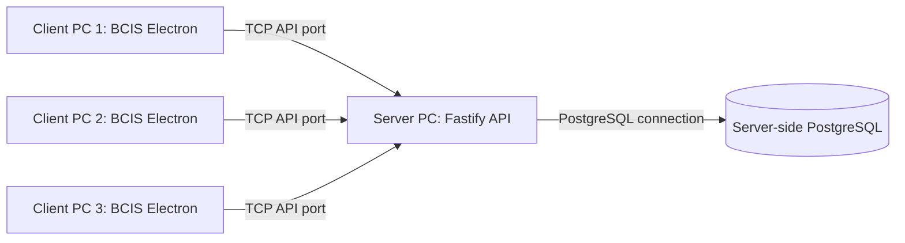

# BCIS LAN Deployment Guide

This guide describes a recommended private-LAN topology, not proof that a three-PC deployment has passed acceptance. Record the actual server address, firewall rule, installer version, and client test results during installation; do not put credentials or live subscriber information in the submission.

## 1. Recommended topology

Use three Windows desktop clients, one Fastify API on the server PC, and one PostgreSQL database on that same server (or on a separately protected server VLAN). Client PCs communicate with the API over HTTP; PostgreSQL is never accessed directly by Electron.



Current API transport is plain HTTP. Restrict it to a trusted private LAN/VPN, or place it behind an approved TLS reverse proxy for deployments requiring encryption in transit. Do not expose the service publicly.

## 2. Server prerequisites and PostgreSQL

Server PC:
- Windows with a stable/reserved private IPv4 address.
- Node.js/npm supported by the project, PostgreSQL, and PostgreSQL client tools (`pg_dump`, `pg_restore`) for backups.
- Project source/deployment copy and local administrator permission to configure services and firewall.
- Protected storage with adequate free space for database and backups.

Database:
1. Install and start PostgreSQL on the server.
2. Create a BCIS database and least-privilege application role; keep its credentials on the server.
3. Keep PostgreSQL's port (normally 5432) blocked from client PCs. Do not place `DATABASE_URL` on clients or in Electron package config.
4. Configure `DATABASE_URL` in a protected server environment or an untracked local `server/.env`.

## 3. Production environment variables

`server/src/lib/config.ts` recognizes:

| Name | Use |
| --- | --- |
| `HOST` | API bind address; set to `0.0.0.0` to listen on server interfaces. |
| `PORT` | API port; default is `3000`. |
| `DATABASE_URL` | PostgreSQL connection string, server only. |
| `JWT_SECRET` | Configured secret variable; current API session tokens are process-memory random tokens, not JWTs. |
| `PG_DUMP_PATH`, `PG_RESTORE_PATH` | PostgreSQL executable names or absolute paths. |
| `BCIS_BACKUP_DIRECTORY` | Protected server-side backup directory. |
| `BCIS_RESTORE_DATABASE_URL` | Isolated restore destination; its DB name must end with `_restore`. |
| `BCIS_ENABLE_RESTORE` | Restore feature opt-in, still unavailable when `NODE_ENV=production`. |

`NODE_ENV`, `BCIS_DEMO_SEED`, and `BCIS_DEMO_PASSWORD` are also consulted by startup/seed code. Demo seed is not a production setup path. Do not use source/default credentials as production credentials; secure/rotate any bootstrap account before LAN use. Never share environment values, passwords, tokens, or URLs in a public report.

## 4. Install, build, and start the API

From PowerShell on the server:

```powershell
cd C:\path\to\BCIS\server
npm ci
$env:HOST = '0.0.0.0'
$env:PORT = '3000'
$env:DATABASE_URL = '<server-only PostgreSQL connection string>'
$env:JWT_SECRET = '<unique strong server secret>'
npm run build
npm run migrate
npm run start
```

Provide every required value through the server's protected environment before starting. `npm run migrate` invokes `drizzle-kit push`; review schema changes and back up valuable data before applying. The `start` script runs `node dist/src/index.js`, so build first. `npm run dev` runs `tsx watch src/index.ts` for development only.

The API binds to `HOST`/`PORT`, with defaults `0.0.0.0:3000`. `0.0.0.0` is a bind address, not a URL clients should use.

## 5. Find server LAN IPv4 and configure firewall

1. On the server, run `ipconfig` and record the active private-network adapter's **IPv4 Address**. Prefer a DHCP reservation/static address through the network administrator.
2. Add a Windows Defender Firewall inbound TCP allow rule for the API port (default 3000).
3. Restrict the rule to the **Private** profile and, where policy allows, the trusted client subnet or client IPs. Do not enable an unrestricted Public-profile rule.
4. Do not add a client-accessible PostgreSQL firewall rule. Permit database traffic only as required between the API process and the database host.
5. From a client, test the exact server address, e.g. `http://<server-LAN-IPv4>:3000/api/health`.

Health endpoints are:
- `GET http://<server-LAN-IPv4>:3000/api/health`
- `GET http://<server-LAN-IPv4>:3000/api/v1/health`

Both return a successful API response when the route is reachable. They do not guarantee PostgreSQL readiness. `/`, `/health`, and `/api/docs` are not registered endpoints.

## 6. Install Windows desktop clients

The existing x64 NSIS installer is:

`bcis-system\release\1.0.0\BCIS-Windows-1.0.0-Setup.exe`

Copy it to each client through an approved channel, verify it is the approved release artifact, then run the installer and follow its prompts. It is not documented as code-signed; follow the organization's Windows application approval policy. No PostgreSQL installation, database role, or database password belongs on a client.

## 7. Configure each client API address

The Electron main process reads `bcis-config.json` from `app.getPath('userData')`. The packaged `package.json` name is `bcis-system`; Electron's Windows `userData` directory therefore resolves under the current user's roaming app-data directory:

`%APPDATA%\bcis-system\bcis-config.json`

If the directory does not exist, create it. File contents:

```json
{
  "apiBaseUrl": "http://<server-LAN-IPv4>:3000"
}
```

Use valid JSON, no trailing comma, and omit a trailing slash. Replace the placeholder with the server's actual LAN address; do not include database credentials. An inherited `BCIS_API_BASE_URL` environment variable takes precedence over this JSON config. Restart BCIS after a change.

The exact runtime path is determined by Electron's `app.getPath('userData')`; if the installation uses a different Electron app name or app-data policy, confirm it on the client rather than guessing. The app's current fallback is `http://localhost:3000`, which is not suitable for remote client PCs.

## 8. Login verification and three-client acceptance

For each client:
1. Open the health URL in a browser: `http://<server-LAN-IPv4>:3000/api/health`.
2. Start BCIS and confirm the sidebar reports **API connected**.
3. Sign in using an assigned active staff account.
4. Read a known synthetic subscriber or dashboard value.
5. On a controlled test record, perform a permitted write on one client and verify it appears after refresh on the other two.
6. Exercise concurrent changes to separate synthetic invoices/payments and reconcile the resulting balances; retain redacted procedure, timings, screenshots, and database/log evidence.
7. Verify a client cannot connect to PostgreSQL's port directly.

Do not use production financial/customer data for acceptance. The repository currently contains no evidence that this multi-PC procedure has been completed. Mark the three-PC requirement pending until all three physical PCs have been tested.

## 9. Backup, restore, and recovery

- Create backups from the **Backup & restore** screen (OWNER/ADMINISTRATOR) or authorized API flow. Files are generated on the API server under `BCIS_BACKUP_DIRECTORY`.
- The API runs `pg_dump` custom format and validates the output with `pg_restore --list`. Store backup data on protected server storage and copy an independent backup according to institutional policy.
- Monitor free space and verify backup history, file existence, and restore evidence.
- Restore UI/API is restricted to OWNER and only an isolated database name ending `_restore`; it requires opt-in and is always rejected in production. `pg_restore --clean` is destructive to that target.
- Production restore is not an in-app feature. Establish and test a separately approved disaster-recovery runbook against a non-production clone before relying on this system.
- Never run `npm run test:backup:real` against production; it creates and drops temporary databases. It requires `pg_dump`, `pg_restore`, and `pg_amcheck`.

## 10. Troubleshooting, shutdown, and restart

| Problem | Check |
| --- | --- |
| Client cannot connect | Confirm API process, configured `apiBaseUrl`, server IP, Private firewall rule, and TCP port. |
| `/` or `/api/docs` returns 404 | These routes are not registered. Test `/api/health` or `/api/v1/health`. |
| Health works but login/data fails | API health does not test DB readiness. Check PostgreSQL, server-only `DATABASE_URL`, and startup logs. |
| Client still calls localhost | Check `%APPDATA%\bcis-system\bcis-config.json`, JSON syntax, environment override, then restart the client. |
| Sessions fail after API restart | Current auth sessions are held in API process memory; users must sign in again. |
| Backup utility missing | Install PostgreSQL client tools or set server-only `PG_DUMP_PATH`/`PG_RESTORE_PATH`. |

Shutdown: stop the API process cleanly (Ctrl+C when running in a console), then stop PostgreSQL only when needed for maintenance. Restart PostgreSQL first, then the API, verify health and database-backed login, and confirm clients reconnect. Restart invalidates current in-memory API sessions.
