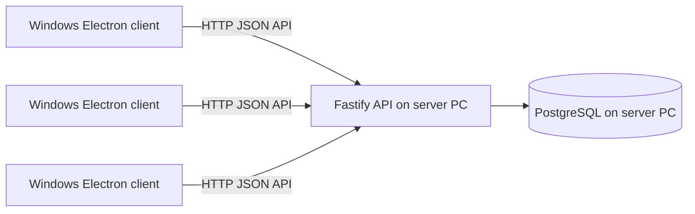

# BCIS — Subscription Billing and Collection System

BCIS is a school laboratory project for managing subscribers and service accounts, recurring billing, payments, field collections, receivables, and service lifecycle records. It is a Windows desktop application built with Electron and React, backed by a Fastify API and PostgreSQL database.

## Objectives

- Maintain subscriber, service-account, plan, and collection-area records.
- Generate cycle invoices and track payments, allocations, receipts, and account ledger entries.
- Support collector assignments, collection batches, remittance records, and receivables aging.
- Apply authenticated, role-gated API operations and retain audit history.
- Keep PostgreSQL access on the server; desktop clients communicate with the API only.

## Implemented features

- Dashboard summary of subscriber/service counts, balances, pending payments, open batches, and recent invoices.
- Subscriber register with search, create/edit, profile, addresses, and additional contacts.
- Service-account create/edit linked to existing subscribers and plans.
- Billing-cycle create/list, invoice generation, invoice register, item and adjustment API operations.
- Payment recording, invoice allocation (manual and oldest-first), GCash proof/verification, and reversible posted payments.
- Receipt issue and register/filter functions.
- Collection assignments, batches, account collections, collector remittances, and reconciliation records.
- Receivables and aging buckets; suspension/reconnection workflow.
- Invoice, payment, collection, receivable, suspension, reconnection, and ledger reports with Excel/PDF exports.
- Sanitized audit-log viewer and server-side PostgreSQL backup creation.
- Restore is restricted to an isolated `_restore` database outside production; it is disabled in production.

The application does **not** currently provide a user/role administration screen, service-plan catalog editor, or in-app receipt printing control. These limitations are documented in the technical documentation and user manual.

## Technology and architecture

- Desktop: Electron 30, React 18, TypeScript, Vite, React Router, React Hook Form, Zod.
- API: Fastify 5, TypeScript, Zod, `@fastify/cors`.
- Data: PostgreSQL, `pg`, Drizzle ORM, Drizzle Kit.
- Tests: Node test runner through `tsx`; server integration tests use the configured database when available.



Electron preload exposes a narrow `bcisApi` bridge; the renderer does not get database credentials or direct PostgreSQL access. Configure each packaged client with its server API URL as described in [DEPLOYMENT.md](./DEPLOYMENT.md).

## Repository structure

```text
bcis-system/                  Electron + React client
  electron/                   Electron main and preload
  src/                        React UI and API client
  release/1.0.0/              Existing Windows installer and unpacked app
server/                       Fastify API
  db/schema.ts                Drizzle schema
  drizzle/                    Generated SQL and migration journal
  src/routes/                 HTTP route modules
  src/services/               Domain services
  test/                       Backend integration test suite
  scripts/                    Real backup/restore verification
docs/                         Technical, user, testing, release documentation
DEPLOYMENT.md                 LAN installation and operations guide
```

## Prerequisites

- Windows 10/11 for the packaged client and Windows server deployment.
- Node.js and npm versions supported by the checked-in dependencies.
- PostgreSQL on the API server, plus a database and an application role.
- PostgreSQL client utilities (`pg_dump`, `pg_restore`) on the server for backup operations.

Do not commit `.env` files or place production secrets, real subscriber data, or payment details in source control. Configure server secrets in the server process environment or a locally protected `server/.env` file excluded from source control. `DATABASE_URL` is server-only.

## Install and configure

Install dependencies in each project:

```powershell
cd C:\path\to\BCIS\server
npm ci

cd C:\path\to\BCIS\bcis-system
npm ci
```

Set the server's `DATABASE_URL` to the PostgreSQL instance and database. Set a strong `JWT_SECRET` and production-safe `HOST`/`PORT`; deployment configuration is detailed in [DEPLOYMENT.md](./DEPLOYMENT.md). The server config schema also recognizes `PG_DUMP_PATH`, `PG_RESTORE_PATH`, `BCIS_BACKUP_DIRECTORY`, `BCIS_RESTORE_DATABASE_URL`, and `BCIS_ENABLE_RESTORE`.

From `server`, apply the current schema with:

```powershell
npm run migrate
```

This script runs `drizzle-kit push` against `DATABASE_URL`; it is not a separate production migration runner. Review schema changes and take a database backup before applying changes to valuable data.

Optional synthetic seed, for a non-production database only:

```powershell
$env:BCIS_DEMO_SEED = 'true'
$env:BCIS_DEMO_PASSWORD = '<choose-a-local-demo-password>'
npm run seed:demo
```

The seed is opt-in and disabled for production. Seed contents and limitations are described in [server/README.md](./server/README.md).

## Development, production, and package commands

Run the API in watch mode from `server`:

```powershell
npm run dev
```

Run the Electron/Vite development app from `bcis-system`:

```powershell
npm run dev
```

Build the API JavaScript:

```powershell
cd C:\path\to\BCIS\server
npm run build
npm run start
```

Check frontend TypeScript and lint:

```powershell
cd C:\path\to\BCIS\bcis-system
npx tsc --noEmit
npm run lint
```

Build the frontend and package the Windows Electron installer:

```powershell
cd C:\path\to\BCIS\bcis-system
npm run build
```

The client build script runs TypeScript, Vite, and electron-builder; the configured output directory is `bcis-system/release/<version>/`. The existing installer is [BCIS-Windows-1.0.0-Setup.exe](./bcis-system/release/1.0.0/BCIS-Windows-1.0.0-Setup.exe). Do not interpret artifact existence as successful installation or LAN acceptance.

## Tests and verified results

Backend test command:

```powershell
cd C:\path\to\BCIS\server
npm test
```

The last captured backend run on 2026-10-11 reported **10 passed, 0 failed, 0 skipped**. The suite is integration-oriented and uses the configured database when available; review its test setup and target a safe non-production database before running it. Frontend `package.json` has no test script or frontend unit-test suite.

The result is automated-code evidence only. Lab acceptance, real PostgreSQL utility backup/restore, installer clean-install, and separate-PC concurrency evidence are tracked individually in [docs/TESTING_REPORT.md](./docs/TESTING_REPORT.md) and [docs/RELEASE_CHECKLIST.md](./docs/RELEASE_CHECKLIST.md).

## Documentation

- [Technical documentation](./docs/TECHNICAL_DOCUMENTATION.md)
- [User manual](./docs/USER_MANUAL.md)
- [Testing report](./docs/TESTING_REPORT.md)
- [Deployment guide](./DEPLOYMENT.md)
- [Release checklist](./docs/RELEASE_CHECKLIST.md)
- [Server backup and demo-seed notes](./server/README.md)

## Laboratory deliverables

| ID | Deliverable | Repository evidence / status |
| --- | --- | --- |
| D1 | Source Repository | This repository; keep credentials and live data out of it. |
| D2 | Working Release | Existing Windows installer; clean-install and LAN checks remain separate release evidence. |
| D3 | Technical Documentation | [docs/TECHNICAL_DOCUMENTATION.md](./docs/TECHNICAL_DOCUMENTATION.md) |
| D4 | User Manual | [docs/USER_MANUAL.md](./docs/USER_MANUAL.md) |
| D5 | Testing Package | [docs/TESTING_REPORT.md](./docs/TESTING_REPORT.md) and `server/test/` |
| D6 | Reports | Implemented in-app reporting/export; representative approved synthetic report outputs still need to be collected for submission. |
| D7 | UI Evidence | Screenshots are not present in the repository; collect and add them before submission. |
| D8 | Presentation/Defense | Prepare separately using the actual running system and verified evidence. |

The source implements the API/data workflows, but final school-project acceptance still depends on the manual tests and artifacts listed as pending.
