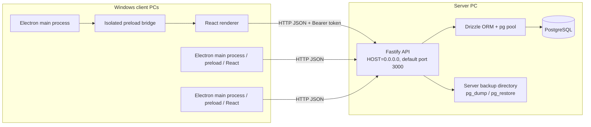
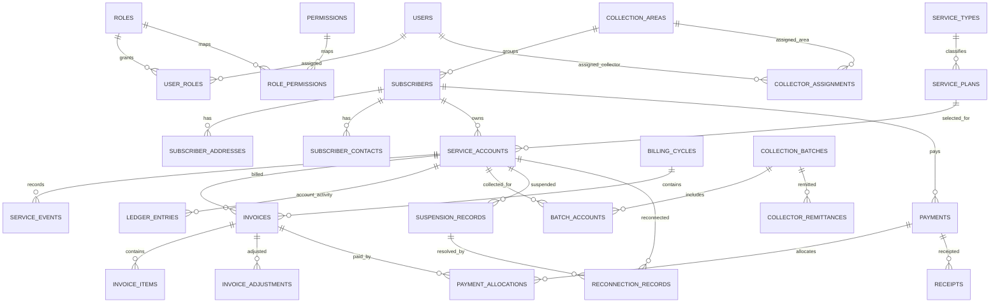

# BCIS Technical Documentation

## 1. Introduction, objectives, scope, and requirements

BCIS is a school laboratory application for broadband subscription billing and collection operations. It is a Windows desktop client backed by a server-side Fastify API and PostgreSQL.

### Objectives

- Keep subscriber and service-account records consistent.
- Generate recurring invoices from active service accounts and billing cycles.
- Record payments and apply them to invoices while keeping account ledger records.
- Support collector assignments, field batches, remittances, and receivable aging.
- Restrict operations by authenticated role and retain auditable financial/service events.
- Keep database credentials and PostgreSQL connections on the server.

### Implemented scope

The repository contains subscriber and service-account workflows; service type, plan, and collection-area read/list APIs; cycles, invoice generation, invoice items/adjustments APIs, payments/allocations/reversals, receipts, ledger, collections/remittance, receivables, suspension/reconnection, reports, audit history, and server-side backup endpoints.

The desktop UI is narrower than the API: there is no user/role administration page or service-plan catalog editor. The route surface has user/role and plan create/update operations, but users must not assume those operations have a UI or that every operation is available to every role. In-app printing of receipts is not implemented. There is no HTTP documentation endpoint or generated API reference.

### Deployment requirements

The API server and PostgreSQL are hosted on one server PC or approved server environment. Desktop clients access only the Fastify HTTP API. LAN firewall policy should expose only the API port to trusted private-network clients; PostgreSQL should not be reachable from client PCs. Current API transport is HTTP and should remain restricted to a trusted private network or protected by a separately configured TLS-terminating reverse proxy.

## 2. System architecture



`electron/main.ts` loads a local packaged renderer and attaches `electron/preload.ts`. The renderer calls the narrow `window.bcisApi` API bridge. It has no PostgreSQL driver or database URL. The API uses `pg` through Drizzle and opens the database connection itself.

## 3. Stack and repository structure

| Layer | Implementation |
| --- | --- |
| Desktop shell | Electron 30, Vite Electron plugin |
| UI | React 18, TypeScript, React Router, React Hook Form, Zod |
| UI data/API | `src/api.ts` fetch wrapper; isolated preload bridge in production |
| API | Fastify 5 with CORS plugin |
| Validation/data | Zod, Drizzle ORM, `pg` |
| Database | PostgreSQL |
| Packaging | electron-builder, Windows NSIS x64 |
| Backend tests | `tsx --test test/auth.integration.test.ts` |

```text
bcis-system/
  electron/main.ts, preload.ts     Electron lifecycle, runtime config, API bridge
  src/App.tsx, Workspace.tsx       Login, navigation, page workflows
  src/api.ts                       HTTP API client
  electron-builder.json5           NSIS x64 package metadata and output
  release/1.0.0/                   Existing installer and unpacked release
server/
  db/schema.ts                     Drizzle table declarations
  drizzle/*.sql, meta/             Generated SQL and Drizzle journal/snapshot
  src/index.ts                     Fastify construction, routes, health, listen
  src/routes/*.ts                  Endpoint handlers/authorization/validation
  src/lib/*.ts                     Config, auth, DB initialization, audit
  src/services/billing.ts          Invoice generation and draft recalculation
  src/seed-demo.ts                 Opt-in synthetic data seed
  test/auth.integration.test.ts    Backend integration tests
  scripts/backup-restore-real.ts   Explicit real-utility verification workflow
docs/                               Project technical/user/testing/checklist docs
DEPLOYMENT.md                       Server/client deployment instructions
```

## 4. Implemented modules

| Module | Implemented behavior |
| --- | --- |
| Dashboard | Loads counts/activity and aggregates outstanding and overdue balances from API data. |
| Subscribers | Search, create/edit, details, addresses and contacts. |
| Service accounts | List, create and edit linked subscriber, plan, and billing fields. |
| Plans/reference data | Service types, plans, collection areas have API operations; no desktop plan/reference-data editor screen. |
| Billing | Create/list cycles, generate invoices for a cycle, and view invoice register. API also exposes invoice items and adjustment operations. |
| Payments | Record cash/digital/other payment methods; allocate to invoice manually or oldest-first; add/verify GCash proof; reverse posted payment with reason. |
| Receipts | Issue receipts for posted payments and filter/view receipt history. No receipt print control. |
| Collections | Collector assignment, batch creation, accounts and collections, remittance creation and reconciliation records. |
| Receivables | Per-service outstanding/overdue totals and aging; account detail includes invoices. |
| Suspension/reconnection | Record suspension for eligible account in the receivables workflow; complete reconnection and retain history. |
| Reports | Filter/export invoice, payment, collection/remittance, receivables, suspension, reconnection, and ledger views to XLSX/PDF; collection batches can also be exported. |
| Audit | Role-restricted filtered audit history with sanitized value display. |
| Backup | Server-side custom-format dump creation, `pg_restore --list` validation and metadata; constrained non-production restore. |

## 5. Database design

The canonical schema is `server/db/schema.ts`. Tables use integer serial primary keys. Foreign keys tie dependent records to their owners; account numbers, plan codes, cycle codes, payment/receipt numbers, and batch numbers have unique constraints where declared. Financial amounts use `numeric(..., 2)` columns; business code performs exact arithmetic with integer cents for selected calculations. Indexes cover common account, date, status, and lookup columns.

### Table catalog

| Area | Tables and purpose |
| --- | --- |
| Security | `roles`, `permissions`, `role_permissions`, `users`, `user_roles`: user identities, role association, permission catalog and role-permission links. |
| Subscribers | `collection_areas`, `subscribers`, `subscriber_addresses`, `subscriber_contacts`: account/profile, optional assigned area/collector, address and contact details. |
| Service | `service_types`, `service_plans`, `service_accounts`, `service_events`: catalog, service subscription and recorded service events. |
| Billing | `billing_cycles`, `invoices`, `invoice_items`, `invoice_adjustments`: cycle periods, account invoices, line items, reasoned adjustments. |
| Accounting | `ledger_entries`: account debit/credit events linked when applicable to invoices and payments. |
| Payments | `payments`, `payment_allocations`, `payment_proofs`, `payment_reversals`: received amount/method, invoice allocation, proof metadata and reversal reason. |
| Receipts | `receipts`: unique receipt number, payment relation, active/void status metadata. |
| Collections | `collector_assignments`, `collection_batches`, `batch_accounts`, `collector_remittances`: territory/time assignments, batch expected/collected totals and remittance variance. |
| Service lifecycle | `suspension_records`, `reconnection_records`: dated suspension and reconnection request/completion/fee/status. |
| Operations | `audit_logs`, `application_settings`, `backup_history`: audit events, settings, backup metadata (backup data files themselves reside on the server filesystem). |

### Principal relationships



The diagram shows core foreign-key relationships only, not every optional user/audit relation. `payment_allocations.payment_id` and `ledger_entries.payment_id` are declared as integer columns without Drizzle FK declarations in the current schema; do not infer database-enforced foreign keys for those columns from the diagram.

## 6. Authentication, roles, routes, and Electron boundary

### Authentication and authorization

- `POST /api/v1/auth/login` verifies an active database user and returns a random bearer token.
- Current tokens/sessions are stored in a process-local in-memory `Map`, with an eight-hour expiration. Restarting the API clears active sessions; multiple API instances do not share session state.
- Password storage uses PBKDF2-SHA512 with random salts for current hashes, supports a legacy hash format, and upgrades legacy hashes after successful login.
- Failed/rejected/successful login and logout events are audit logged.
- `requireAuth` and `requireRole` enforce authentication/role restrictions in route handlers.
- `ensureDemoAdmin` ensures a bootstrap admin record/OWNER association when the database initializes. Its implementation contains a bootstrap password; it is not repeated here. Replace/secure bootstrap credentials before deployment and never treat development defaults as production secrets.

Role names seeded/recognized by code include `OWNER`, `ADMINISTRATOR`, `CASHIER`, `COLLECTION_SUPERVISOR`, `ACCOUNTING_AUDITOR`, `TECHNICIAN`, and `VIEWER`. API/UI authorization is implemented as role-name allowlists in code; `roles`/`permissions`/`role_permissions` schema tables do not by themselves mean every route consults a configurable permission matrix.

Key implemented role boundaries include:

| Operation | Role gate visible in implementation |
| --- | --- |
| User directory / user administration API | `OWNER`, `ADMINISTRATOR` |
| Billing cycle writes and invoice generation | `OWNER`, `ADMINISTRATOR` |
| Payment create/allocation/receipt write | `OWNER`, `ADMINISTRATOR`, `CASHIER` |
| Payment reversal and GCash verification | `OWNER`, `ADMINISTRATOR` |
| Collection management | `OWNER`, `ADMINISTRATOR`, `COLLECTION_SUPERVISOR`; collection write also includes `CASHIER` |
| Audit log access | `OWNER`, `ADMINISTRATOR`, `ACCOUNTING_AUDITOR` |
| Backup create/list | `OWNER`, `ADMINISTRATOR`; restore is `OWNER` only |
| Reports/ledger visibility in UI | role list in `bcis-system/src/roles.ts` |

Some read endpoints require any authenticated session. Consult route handlers for an exact operation's authorization; the table is an overview, not a substitute for per-endpoint rules.

### API route catalog

All routes below are registered directly at their full path; there is no global `/api` or `/api/v1` registration prefix added by `index.ts`. Authenticated endpoints use an `Authorization: Bearer <token>` header unless stated otherwise.

| Route group | Declared route templates |
| --- | --- |
| Health | `GET /api/health`; `GET /api/v1/health` |
| Authentication/users/reference data | `POST /api/v1/auth/login`, `POST /api/v1/auth/logout`, `GET /api/v1/auth/me`; `/api/v1/users`, `/api/v1/roles`, `/api/v1/permissions`, `/api/v1/service-types`, `/api/v1/service-plans`, `/api/v1/collection-areas` (methods vary; source has user create/update/role update and reference list/create/update operations). |
| Subscribers/services | `/api/v1/subscribers`, `/api/v1/service-accounts`, `/api/v1/service-events` and `/:id` GET; subscriber/service account create/update and service event create. |
| Billing/invoices | `/api/v1/billing-cycles` and `/:id`; `POST /api/v1/billing/generate`; `/api/v1/invoices` and `/:id`; `/api/v1/invoices/:invoiceId/items`, `/api/v1/invoice-items/:id`, `/api/v1/invoices/:invoiceId/adjustments`, `/api/v1/invoice-adjustments/:id`. |
| Payments/ledger/receipts | `/api/v1/payments` and `/:id`; `/:paymentId/allocations`, `/:paymentId/allocate-oldest`, `/:id/proof`, `/:id/verify`, `/:id/reverse`; `/api/v1/receipts` and `/:id`; `/api/v1/ledger` and `/:id`. |
| Collections | `/api/v1/collection-assignments`; `/api/v1/collection-batches` and `/:id`; `/:id/accounts`; `/:id/accounts/:accountId/payments`; `/api/v1/collector-remittances` and `/:id`. |
| Receivables/service lifecycle | `GET /api/v1/receivables`; `/api/v1/suspensions` and `/:id`; `/api/v1/reconnections` and `/:id`. |
| Audit/backup | `/api/v1/audit-logs` and `/:id`; `GET/POST /api/v1/backups`; `POST /api/v1/backups/:id/restore`. |

There is no registered `/`, `/health`, or `/api/docs` route. The health URLs are `/api/health` and `/api/v1/health`. The current API package does not include Swagger/Fastify Swagger registration.

### Electron security boundary

`BrowserWindow` configures `contextIsolation: true` and `nodeIntegration: false`. The preload exposes `bcisApi.request` and `bcisApi.health` using `contextBridge`; the renderer does not receive a PostgreSQL connection or general database API. There are no app-specific `ipcMain` business handlers in the reviewed Electron main file. The current packaged API URL is configured with runtime `bcis-config.json` or `BCIS_API_BASE_URL`; see [DEPLOYMENT.md](../DEPLOYMENT.md). The configured API is HTTP unless an external TLS proxy is separately deployed.

## 7. Billing and financial workflows

### Invoice generation

`POST /api/v1/billing/generate` is restricted to owner/administrator. `generateInvoicesForCycle` locks the cycle row in a transaction, requires status `OPEN`, selects active accounts with active plans, and creates one invoice per account/cycle. Existing invoices are skipped and the unique `(service_account_id, billing_cycle_id)` constraint plus conflict handling protects against duplicate invoices. Each generated invoice has a subscription item and corresponding debit ledger entry. Billing amounts are represented to two decimals; the service converts string values to integer cents for calculations.

### Invoice totals

Draft invoice totals are recalculated from line items and adjustments; discount amounts reduce totals, penalties increase them, and other adjustment types contribute their signed amount. A negative total is rejected. Recalculation updates paid/balance-derived invoice state based on posted allocations. Finalized invoices are not editable through draft-only recalculation.

### Payments and allocation

Payment creation validates a positive amount and supported method. GCash requires a reference number. Payment/allocation routes use database transactions and row locks in key financial operations; duplicate references are checked under a PostgreSQL advisory transaction lock. An allocation must be connected to a valid invoice; posted allocations contribute to paid balances and invoice status. Oldest-first allocation is an explicit operation. Reversals retain original payment and reversal reason/history and create balancing ledger entries rather than deleting the original payment. Check route code/test coverage for edge behavior before using as a production accounting system.

### Ledger, receipts, collections, and receivables

- Ledger rows represent debits/credits against a service account, with invoice/payment references where supplied.
- Receipts can be issued only against posted payments; receipt identifiers are unique. Receipt void metadata exists in schema, but do not infer a UI void workflow unless one is explicitly added.
- Collection batches track account expected and collected amounts, cash/non-cash batch totals, and remittance expected cash, remitted cash, and difference. Route services preserve transaction boundaries and audit records for financial state changes.
- Receivables are derived from non-draft invoices less allocations associated with `POSTED` payments. Balances are calculated in integer cents, and due-date buckets are current, 1–30, 31–60, 61–90, and over 90 days.
- Dashboard/report values are derived from the APIs; verify all required accounting policy and acceptance scenarios with the institution before operational use.

## 8. Validation, errors, audit, and integrity

Route inputs use Zod parsing for identifiers, dates, amounts, statuses, and required fields. Invalid values generally return 400 responses; missing auth returns 401, insufficient role returns 403, missing records 404, unavailable DB 503, and invalid state/conflict conditions may return 409. API responses use `success`, message, and data conventions in most route handlers.

Database primary/foreign/unique constraints enforce declared structural integrity. Transactions group operations such as invoice creation, payment application/reversal, and collections. Amounts are stored as `numeric`; selected code paths avoid floating-point monetary math by using integer cents.

`writeAuditLog` stores actor, action, entity, optional reason and before/after values, and request IP where passed. Audit values redact fields whose keys resemble passwords, tokens, authorization, secrets, credentials, API keys, sessions, or cookies; the audit read route sanitizes stored JSON again. One audit write helper warns and continues if an out-of-transaction audit insert fails, so audit durability is not guaranteed for every non-transactional operation. The DB initializer logs unavailable database status and permits a limited-mode API startup; application database operations then return failures/unavailable responses.

## 9. Configuration, schema push, and seed

Server config is parsed by `server/src/lib/config.ts` and loads dotenv. Names recognized there:

| Variable | Purpose |
| --- | --- |
| `HOST` | Fastify bind host; default `0.0.0.0`. |
| `PORT` | Fastify listen port; default `3000`. |
| `DATABASE_URL` | Server-side PostgreSQL connection string. |
| `JWT_SECRET` | Configured environment value; current authentication uses process-memory opaque tokens, not JWT signing. |
| `PG_DUMP_PATH`, `PG_RESTORE_PATH` | PostgreSQL client utility executable names/paths. |
| `BCIS_BACKUP_DIRECTORY` | Server filesystem backup location; default resolved relative to server process CWD. |
| `BCIS_RESTORE_DATABASE_URL` | Dedicated restore target URL; target DB must end `_restore`. |
| `BCIS_ENABLE_RESTORE` | Restore opt-in; restore still rejects production mode. |

The client main process reads `BCIS_API_BASE_URL` environment override or `<userData>/bcis-config.json` containing `{ "apiBaseUrl": "http://server-ip:3000" }`. Environment configuration has precedence over the JSON file. The URL is an API address only and must not contain database credentials.

Schema source: `server/db/schema.ts`; Drizzle Kit config: `server/drizzle.config.ts`; journal currently contains a generated SQL entry under `server/drizzle/`. `npm run migrate` is `drizzle-kit push`; `npm run generate` generates SQL migration artifacts. Demo seed is `npm run seed:demo`, gated by `BCIS_DEMO_SEED=true`, uses `BCIS_DEMO_PASSWORD` or a source-defined development fallback, and refuses `NODE_ENV=production`. Use only synthetic demo values.

## 10. Backup and restore

Backup runs on the server. `POST /api/v1/backups` (owner/administrator) invokes `pg_dump` custom format, stores a generated `.dump` file in `BCIS_BACKUP_DIRECTORY`, checks file type/nonempty status, runs `pg_restore --list`, then records verified metadata and an audit event. PostgreSQL password is placed in the utility child process environment, not the command-line arguments; the client receives metadata, not database credentials.

Restore (`POST /api/v1/backups/:id/restore`) is owner-only and requires successful verified metadata and an existing valid backup file. It requires explicit `BCIS_ENABLE_RESTORE=true`, a `BCIS_RESTORE_DATABASE_URL` targeting a different database with a name ending `_restore`, and is always rejected when `NODE_ENV=production`. It runs `pg_restore --clean --if-exists --exit-on-error`; this is destructive to objects in the configured restore target. Do not enable it on production or point it to valuable data. Production recovery procedure must be separately approved and tested before release.

Automated tests stub external utilities and verify authorization, validation, path safeguards, and metadata. The opt-in `npm run test:backup:real` creates and drops temporary databases and requires an appropriately privileged **non-production** database plus `pg_dump`, `pg_restore`, and `pg_amcheck`; it has not been recorded as run for this submission. See [server/README.md](../server/README.md).

## 11. Testing strategy and verified results

Backend test script: `npm test` (`tsx --test test/auth.integration.test.ts`). The captured run dated 2026-10-11 reported 10 tests passed, 0 failed, 0 skipped. Tests cover auth/RBAC, subscriber/service-event workflow, idempotent billing, payment/allocation and ledger, collector remittance reconciliation, receivables/suspension, audit filters/redaction, demo seed repeatability, Electron API bridge boundary, and backup endpoint safeguards using test utilities.

Backend type/build command: `npm run build` (`tsc -p tsconfig.json`). Frontend typecheck: `npx tsc --noEmit`. Frontend lint: `npm run lint`. `bcis-system` build runs TypeScript, Vite, and electron-builder. No frontend test script exists.

Automated results are not equivalent to lab acceptance. In particular, there is no verified separate-PC concurrency run, no captured screenshots/sample deliverable report package, and no evidence in the repository that the real backup utility workflow or clean installation was executed. Status-by-status detail: [TESTING_REPORT.md](./TESTING_REPORT.md).

## 12. Limitations and future work

Known implementation constraints from source:

- In-memory authentication sessions are lost at API restart and are not shared across API replicas.
- The API's built-in transport is HTTP; public exposure is not appropriate. Add an approved TLS/reverse-proxy arrangement if needed.
- Config includes `JWT_SECRET`, but current session tokens are opaque random tokens stored in memory, not JWTs.
- Startup may report API health while PostgreSQL is unavailable; health indicates process/API availability, not database readiness.
- No in-app user/role administration screen, no plan/reference-data editor, no receipt print workflow, and no Swagger docs endpoint.
- Restore is disabled in production; production disaster-recovery restoration remains an operational process requiring manual validation.
- No verified 3-PC LAN concurrency test, no front-end automated test suite, and no submitted screenshots/presentation assets are present in this repository.

Prioritized improvements: persistent/shared sessions and account session invalidation, DB readiness health reporting, dedicated TLS deployment, fully evidenced restore/recovery procedure, endpoint documentation, UI administration/reference screens if required, comprehensive client acceptance/concurrency testing, and submission artifacts. These are recommendations, not claims of current implementation.
